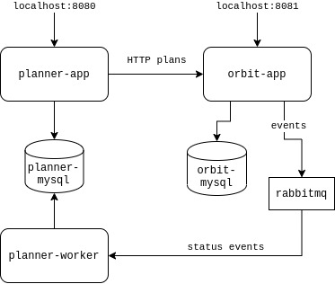
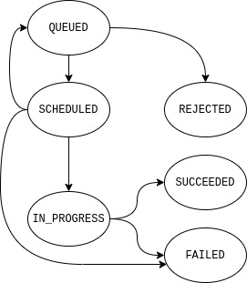

# Fleet Mission Planner & Orbit Execution Engine (FMPE)

This repository contains a prototype of a Fleet Mission Planner & Orbit Execution Engine (FMPE). It ingests capture requests, schedules them into an execution plan, runs the plan in a simulation of a configurable satellite constellation, and tracks the state of each capture as the simulation progresses.

A capture is a request to image a target; a plan assigns captures to satellites; the simulation executes the plan tick by tick and reports what each satellite achieved.

## Quickstart

### Prerequisites

Before you begin, make sure the following are installed in your system:

- [Docker](https://docs.docker.com/get-docker/)
- [kind](https://kind.sigs.k8s.io/docs/user/quick-start/#installation)
- [kubectl](https://kubernetes.io/docs/tasks/tools/)
- [Helm](https://helm.sh/docs/intro/install/)

### Commands

| Command | Description |
|---|---|
| `make up` | `infra-up` + `run` |
| `make infra-up` | Create the cluster and build/load the images |
| `make run` | Install or upgrade the chart, rolling the apps to pick up rebuilt images |
| `make demo` | Execute a demo of the project, end to end |
| `make test` | Execute test cases |
| `make down` | Delete the cluster and all its data |
| `make images` | Build the images and copy them to a cluster |
| `make logs SVC=<name>` | Show logs of `planner-app`, `planner-worker` or `orbit-app` |
| `make status` | List pods and services |
|`make check-tools` | Verifies if [prerequisites](#prerequisites) are installed |

### Run demo
The command `make up` creates a local kind cluster, builds both service images, loads them into the cluster and installs the Helm chart.

| URL | Service |
|---|---|
| http://localhost:8080/docs | Planner API (OpenAPI spec) |
| http://localhost:8081/docs | Orbit Execution API (OpenAPI spec) |
| http://localhost:15672 | RabbitMQ management UI (`orbit` / `orbit`) |

Run `make demo` to execute an end-to-end demo of the project with the current configuration.

After a code change: `make images run`.

### Demo configuration
To change the settings for the demo, modify the following files:

- [**Satellites**](./orbit-execution-service/config/constellation.yaml): contains the satellites specifications.
- [**Captures**](./scripts/captures.json): contains all the captures sent to the planner-app.

## Design decisions

### Project architecture

The project consists of three services running in different containers:
- A `planner-app` that implements a REST API receiving capture and simulation runs requests from customers.
- An `orbit-app` responsible for running the simulations.
- A `planner-worker` that reads the events from the message broker and updates the states of the current plan as well as the captures.

Along with the services there are two MySQL instances (one for each sub-project: planner-service and orbit-execution-service) and a RabbitMQ instance.

  

### Communication mechanism

The communication between services is divided into two parts:
- **HTTP**: the `orbit-app` implements a REST API to receive commands from the `planner-app`, as well as for consulting the constellation configuration.  
- **Message queue**: the `orbit-app` publishes simulation events (plan and capture updates), which the `planner-worker` consumes.

The idea behind this approach is to decouple both operations: Sending commands is synchronous (HTTP); processing events is asynchronous (message queue), so the planner never blocks waiting for the simulation.

### Workflow

This configuration works as follows (happy path):
1. On a `POST /api/v1/simulations` request, the `planner-app` gets the constellation configuration and all the captures with state `QUEUED`.
2. Runs the scheduler and creates an execution plan.
3. Sends the plan by calling `PUT /api/v1/plans/{plan_uuid}` of the `orbit-app`, and responds `202: Accepted` to the client. At this point, the `planner-app` is locked until the plan is completed.
4. The `orbit-app` loads the satellites, assigns the tasks that correspond to each one and starts the simulation (executed in an async thread). Then it responds to the `planner-app`. The `orbit-app` holds its own lock on the simulator.
5. Once the simulation is started, the `orbit-app` sends the satellite updates on every tick to the message broker, until it finishes. The `orbit-app` lock is released when the execution plan is completed.
6. The `planner-worker` collects the events from the broker and updates the states of the captures and the plan. Once the plan is completed, it also releases the lock on its side.

**NOTE**: Plan execution is idempotent because it is protected by a UUID. If the same plan is attempted twice, it will be rejected.

### State management

The capture states are modeled as follows:

  

Transitions are as follows:

- **\* &rarr; QUEUED**: The initial state when a capture is created.
- **QUEUED &rarr; SCHEDULED**: When a capture is assigned to a plan.
- **QUEUED &rarr; REJECTED**: When a capture couldn't be assigned to a plan.
- **SCHEDULED &rarr; IN_PROGRESS**: When a capture is assigned to a satellite.
- **SCHEDULED &rarr; QUEUED**: When a plan can't be dispatched (because the `orbit-app` is unreachable or rejects the plan).
- **IN_PROGRESS &rarr; SUCCEEDED**: When a capture ends successfully.
- **IN_PROGRESS &rarr; FAILED**: When the satellite couldn't capture the image.
- **SCHEDULED &rarr; FAILED**: When a plan is completed and nothing has been registered for this capture (no events received). Perhaps it would be better to have an extra state **ABORTED** to handle this case.

### Simplifications and assumptions

- Each satellite attempts a capture only once. If more attempts are expected it would be necessary to add a `max_num_of_attempts`, and communicate the `attempt_number` value in the `task.attempt` event so the planner knows when a capture has exhausted its attempts.
- It is assumed that all messages are in order with no duplicates. There are no sequence numbers in events and no requeue mechanisms.

### IaC tool
Helm/kind was chosen because the project runs locally with no cloud resources to provision. The same deployment model could be ported to a cloud platform with minor changes (see: [Production readiness](#production-readiness)). By contrast, a Terraform setup written for Docker would have to be thrown away when moving to the cloud, whereas the Helm chart is reused.

The local chart is deliberately minimal. In production the work splits into two layers with different lifecycles:
- **Terraform** for declaring all the necessary infrastructure to run the solution.
- **Kubernetes** for managing the deployment of the project.

## Scheduling algorithm
The execution plan is computed with an exhaustive search, as follows:
1. Create all possible paths for each satellite, following these rules:
    - All targets are listed in the order they are visited from the satellite initial position.
    - Each target is modeled as a window $W$=(target_position±$\Delta\theta_{capture}$), and it can only be added to a path if a satellite is available during the entire window. For instance, suppose the scenario with targets $T_{1}$ and $T_{2}$; if the path already contains the target $T_{1}$, the target $T_{2}$ would be added only if:
    
    $$
    T_{1_{position}}+\Delta\theta_{capture}+\delta_{slew} ≤ T_{2_{position}}-\Delta\theta_{capture}
    $$
2. Create all possible combinations of paths of all satellites provided they don't share targets (cartesian product).
3. Compute a score for each combination. A score is a tuple compared in order of priority, that contains:
    - A negated number of captures (so, lower is better),
    - An ordered list with the priorities of the captures,
    - An ordered list with execution times,
    - An ordered list of request ID (used as a tie-breaker)
4. Choose the combination with the best score.

### Limitations
- This implementation of a scheduling algorithm is too slow, so the application could hang for minutes if there are more than 3 satellites and 10 captures.

## Production readiness

As explained in the previous section, the scheduling algorithm is not optimal for heavy workloads and should be completely replaced by a more robust algorithm. As it stands, it can't be used for realistic constellations.

The IaC was written mainly for local deployment and it would require changes to be ready for deployment on a cloud platform. For example:
- Secrets shouldn't be stored in `values.yaml`.
- The MySQL instance should be disabled and replaced by an AWS RDS or equivalent.
- The RabbitMQ instance should be disabled and a new adapter is necessary for a cloud service like AWS SQS or equivalent.

## Notes
### Improvements

- It would be necessary to implement an outbox pattern in `orbit-app` for reliability in case events are committed to the database but publishing fails.
- Add a `FAILED` plan status so that an interrupted plan releases the lock and can be retried; today, if a plan is aborted, it holds the lock forever.
- Add a mechanism for handling unordered/malformed messages from the message queue.
 

### Known issues 
#### planner-service
- The case where a `plan.completed` event is never received by the planner is not handled. A timeout is required to avoid locking the `planner-app` forever.

#### orbit-execution-service
- There is no mechanism for recovering a stuck lock in the simulator (The `orbit-app` has it own lock, separate from the planer's). If the simulator crashes, the `orbit-app` will remain locked forever.
